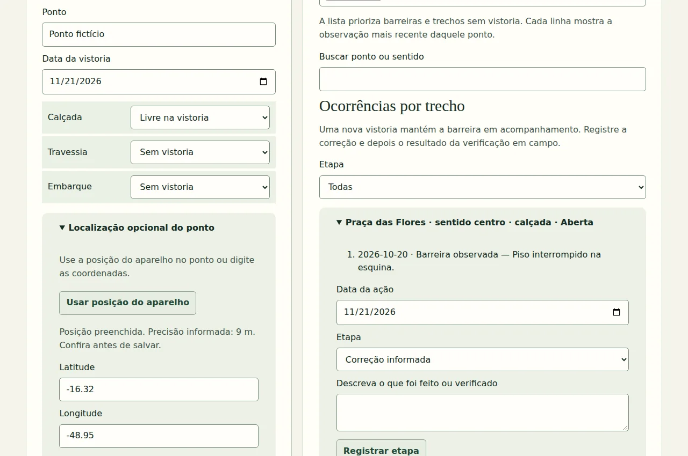

# Últimos 50 Metros

**Experimente em um minuto.** Abra o exemplo fictício, localize a barreira de calçada em **Ocorrências**, registre uma correção e confira o que muda na fila.

[Abrir demonstração](https://ykauttiz.github.io/ultimos-50-metros/) · [Portfólio do Kauê](https://ykauttiz.github.io/contratempo/portfolio/)

Uma vistoria pode encontrar uma barreira na calçada antes mesmo de chegar ao ponto. Este caderno registra separadamente calçada, travessia e embarque. O botão **Ver exemplo fictício** mostra uma esquina com a calçada interrompida.

Baixe o projeto e abra **index.html**. Informe um identificador estável para o ponto (inclua o sentido), a data e o que observou. Use **Sem vistoria** se um trecho ficou por verificar. A fila destaca barreiras e usa a observação mais recente de cada ponto. No mesmo dia, o horário registrado determina a ordem. Se os horários também empatarem, a fila prioriza a última entrada na lista.

Os registros são locais a este navegador e endereço. Exporte o histórico em JSON antes de limpar seus dados. Ao salvar, a página informa se o navegador protegeu o armazenamento contra limpeza automática; quando não protegeu, os dados podem ser apagados se faltar espaço, então exporte com frequência. Se o navegador recusar a gravação por falta de espaço, a vistoria não é salva, o histórico anterior permanece e a mensagem pede a exportação. A fila serve para planejar novas vistorias; uma observação pontual não certifica a acessibilidade de uma rota.

`core.js` valida os registros e organiza a fila. `app.js` controla o formulário e a persistência. Para testar, use Node 20+ e execute `node --test`.

## Aparência e navegação

No cabeçalho, escolha **Sistema**, **Claro** ou **Escuro**. Sistema acompanha o aparelho. O navegador guarda a escolha localmente para a próxima visita. Use Tab para chegar ao atalho de conteúdo e aos controles. As transições respeitam a preferência de movimento reduzido.

## Restaurar um histórico

Em **Restaurar histórico JSON**, selecione um backup exportado pelo aplicativo. A importação valida o arquivo inteiro antes de salvar. Vistorias idênticas entram uma única vez. Se houver observações diferentes do mesmo ponto no mesmo dia, ambas ficam no histórico e a fila prioriza a observação local.

## Histórico de campo

Use a seleção de exibição para alternar entre a fila atual e todas as visitas por data. A tabela identifica o estado de cada trecho separadamente, inclusive quando ainda falta vistoriá-lo.

## Acompanhar uma ocorrência

Identifique o ponto e o sentido no campo de nome. Cada trecho com barreira abre uma ocorrência própria. No cartão da ocorrência, registre a data e a descrição da correção. Uma segunda etapa permite confirmar a correção em campo ou registrar que a barreira persiste. Uma vistoria livre ou incompleta não encerra a ocorrência. Uma barreira observada novamente reabre o acompanhamento. O histórico permanece no navegador e o exemplo fictício pode ser editado separadamente.

O backup versão 2 contém vistorias e ações. A importação também reconhece a lista de vistorias do formato anterior, mostra quantas entradas serão acrescentadas e só grava ao confirmar. Um arquivo inválido ou uma ação conflitante interrompe a restauração. Use nomes consistentes para identificar cada ponto e sentido. Os registros documentam visitas, sem certificar a acessibilidade de uma rota.

Na vistoria, abra **Localização opcional do ponto** e informe latitude e longitude. O botão **Exportar vistorias da seleção em GeoJSON** inclui as vistorias com coordenadas da fila ou histórico filtrado por ponto. O arquivo traz ponto, data e condições dos três trechos. Observações livres e ações permanecem no backup completo.

Antes de sair para a vistoria, clique em **Preparar uso sem internet** com conexão e aguarde a confirmação. A página e os arquivos do aplicativo ficam disponíveis nesse navegador. Limpar os dados do site remove o histórico e o cache. Use o backup JSON para guardar uma cópia das vistorias. Após editar a interface, rode `python prepare_offline.py`.

Em **Vistorias**, selecione um ponto para comparar as duas observações mais recentes. O caderno mostra as datas e o que mudou em calçada, travessia e embarque, inclusive quando uma observação continua igual.

Na área **Vistorias**, selecione a prioridade para ver barreiras, vistorias incompletas ou completas. Os contadores acompanham o ponto pesquisado e a exibição por fila ou histórico. O GeoJSON respeita essa seleção. O histórico e a fila são preparados quando os registros mudam e reutilizados durante a busca.
**Imprimir seleção** gera uma ficha com ponto, data, prioridade e condição dos três trechos. A ficha omite as coordenadas e as observações livres.

No ponto de ônibus, abra a localização opcional e selecione **Usar posição do aparelho**. Revise latitude, longitude e precisão antes de salvar. A entrada manual também funciona quando a permissão é negada.

[Ver testes e capturas de celular e computador](https://github.com/ykauttiz/ultimos-50-metros/actions/workflows/verificar.yml). Na execução, abra o artefato **capturas-chromium** ou **capturas-firefox**. As imagens usam dados fictícios.

A seleção de vistorias pode ser baixada em CSV, sem observações livres ou coordenadas. Para instalar em um navegador compatível, prepare o uso sem internet e use a opção de instalação do navegador.

O CSV neutraliza prefixos de fórmula ASCII, caracteres de controle e variantes Unicode conhecidas antes de abrir o arquivo em uma planilha.

Mapa de coordenadas offline com destaque por ponto, seleção por teclado e descrição textual. Ele usa as coordenadas das vistorias selecionadas e funciona sem mapas externos ou imagens de ruas.

Cada vistoria aceita uma foto opcional. Ao selecionar um arquivo, o caderno cria um JPEG de até 640 pixels a partir dos pixels da imagem. O backup JSON inclui a cópia. CSV, ficha impressa e GeoJSON omitem a foto.

## Privacidade, segurança e contribuição

As vistorias ficam no armazenamento local do navegador. GPS e foto são opcionais. A foto vira um JPEG de até 640 pixels recriado a partir dos pixels da imagem, sem os metadados do arquivo original. O backup JSON inclui a foto; CSV, ficha impressa e GeoJSON a omitem. Evite fotografar rostos, placas e fachadas de moradias.

Para relatar uma falha, veja [SECURITY.md](SECURITY.md). Para propor mudanças, veja [CONTRIBUTING.md](CONTRIBUTING.md). Use somente dados fictícios ou anonimizados em issues e pull requests.

## Publicar uma versão

Atualize `RELEASE.md` com as mudanças verificadas. Para marcar uma entrega, use na branch principal um commit com o título `release(vAAAA.MM.DD) Título da atualização`. Para uma segunda edição no mesmo dia, acrescente um número à versão, como `vAAAA.MM.DD.1`. O GitHub Actions publica a release após a aprovação dos testes. Commits comuns continuam atualizando o site.
